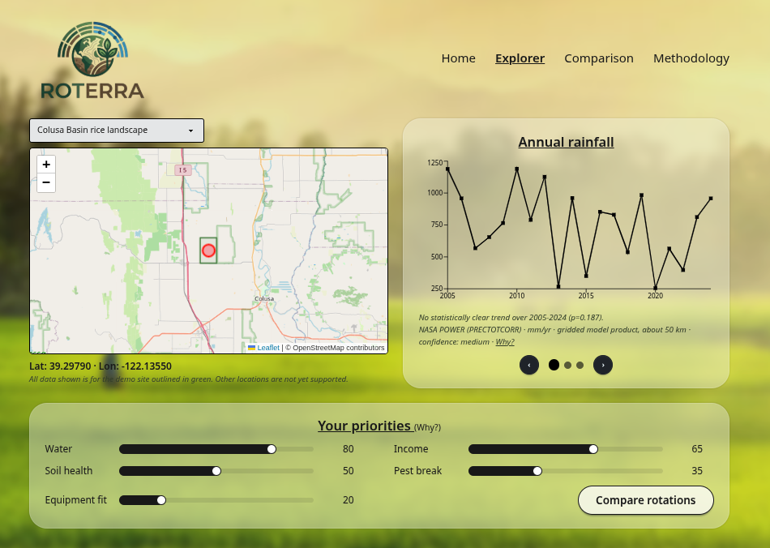
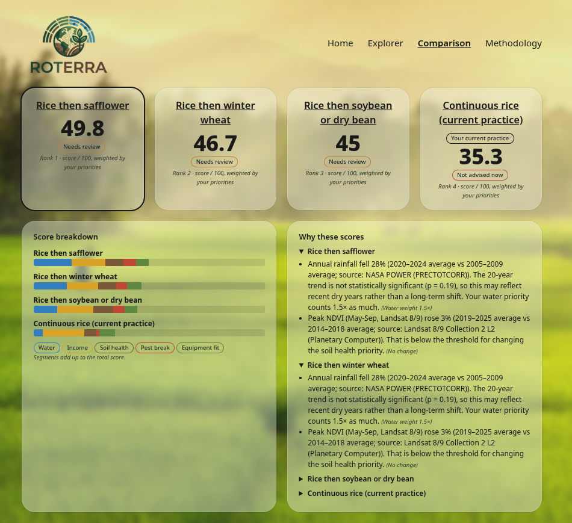
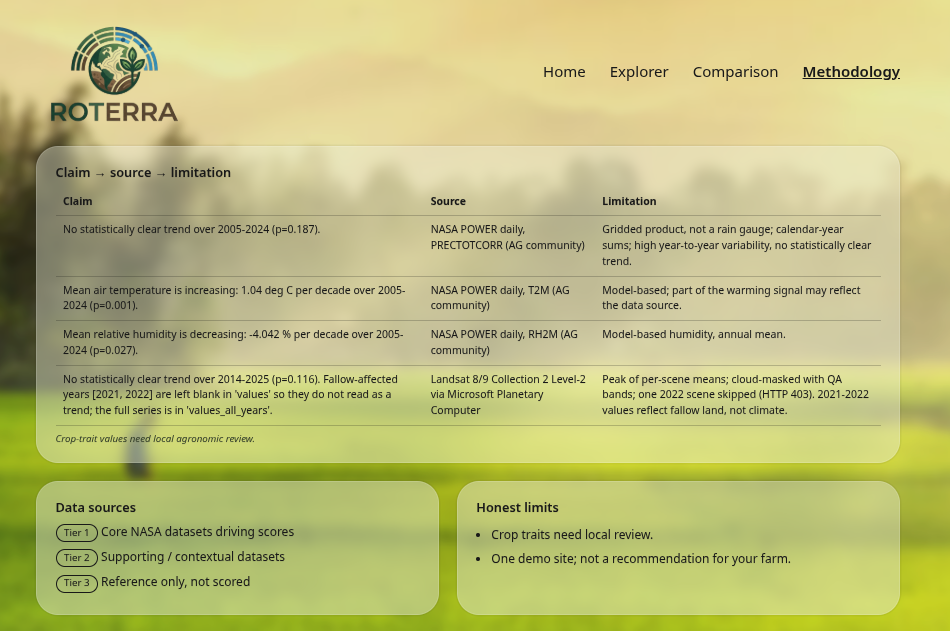

# RoTerra

**Explainable crop-rotation decision support, built on NASA Earth observations and USDA field data.**

RoTerra helps a Sacramento Valley rice grower compare crop-rotation strategies against their own priorities (water, income, soil health, pest pressure and equipment). Every score traces back to its evidence: the exact dataset, resolution and assumptions behind it.

> Built for the NASA Space Apps Challenge 2026 — [Field Shift: Adapting Farms with NASA Data](https://www.spaceappschallenge.org/2026/challenges/field-shift-adapting-farms-with-nasa-data/)

## Live Demo

- App: [https://roterra.earth](https://roterra.earth)
- Demo deck: *add link here, or delete this line*

## The Problem

Rice growers in California's Sacramento Valley face drought cycles, groundwater restrictions and soil-health pressure. NASA Earth observations and USDA field data exist for exactly these decisions, but they are spread across separate portals. None of them answers the farmer's actual question: "given my field and my priorities, which rotation should I consider, and why?"

## What It Does

1. **Understand Risk.** Climate trends (rainfall, temperature, humidity; NASA POWER, 2005–2024) and NDVI (2014–2025) for the demo landscape. Each is labeled with source, resolution and confidence.
2. **Compare Rotations.** Four strategies (a continuous-rice baseline plus three alternatives), scored by a rule-based weighted matrix against priorities the farmer sets with sliders.
3. **Reveal Tradeoffs.** Every score expands into a per-dimension breakdown and the underlying data.
4. **Make Uncertainty Visible.** An evidence drawer shows provenance, limitations and known gaps for each indicator. Where a dataset has no coverage, the app says so instead of guessing.

Observed trends do more than decorate the tool: they adjust the scoring weights, so a drying climate visibly changes which rotations rank. Trends that are not statistically significant are labeled as such.

## How Scoring Works

- Each crop has trait values on a 0–10 scale. A rotation's score on a dimension is the average over the crops in its sequence. Water need is inverted, so high need gives a low water score.
- The five priority sliders (0–100) are multiplied by trend-based multipliers, then normalized to sum to 1.
- Trend rules (in `src/lib/scoringConfig.js`) compare the average of the first and last years of a series:
  - Rainfall down 20% or more raises the water weight 1.5×. Down 10% or more raises it 1.25×. Only the strongest rainfall rule applies.
  - An NDVI decline of 5% or more raises the soil weight 1.25×.
- The total score is the weighted sum, banded as strong-fit, promising, needs-review or not-advised. Ties are broken by rotation id, so the same inputs always give the same output.
- The engine is a set of pure functions with 35 automated tests. It uses no machine learning and no simulated forecasts.

## Screenshots

**Home.** The landing page, with a plain-language summary of the problem and how the tool works.


**Explorer.** The Colusa Basin demo site on a map, NASA POWER rainfall with its significance note, and the five priority sliders.



**Comparison.** Four rotations ranked by score, with a per-dimension breakdown and the reasons behind each score.



**Methodology.** Each claim linked to its source and limitation, plus the honest limits of the demo.



## Data Sources

**NASA (required for the challenge):**
- [NASA POWER](https://power.larc.nasa.gov/docs/): daily precipitation (PRECTOTCORR), temperature (T2M) and relative humidity (RH2M), 2005–2024, ~50 km gridded product.
- [Landsat 8/9 Collection 2 Level-2](https://planetarycomputer.microsoft.com/dataset/landsat-c2-l2): NDVI vegetation index (30 m), 2014–2025, accessed through Microsoft Planetary Computer.

**Other open data:**
- [USDA NASS Cropland Data Layer (CropScape)](https://nassgeodata.gmu.edu/CropScape/): crop history of the demo landscape (30 m), 2014–2025.
- [USDA NRCS SSURGO (Soil Data Access)](https://sdmdataaccess.nrcs.usda.gov/): field-scale soil properties and constraints.
- [OpenET](https://etdata.org/): monthly evapotranspiration (30 m), 2015–2025.
- [Microsoft Planetary Computer](https://planetarycomputer.microsoft.com/): STAC access to Landsat.

**Planned, not yet integrated** (not used in any score):
- [GPM IMERG](https://gpm.nasa.gov/data): rainfall reliability and extremes, ~10 km.
- [SMAP](https://www.earthdata.nasa.gov/data/platforms/space-based-platforms/smap): surface soil moisture (coarse, ~9 km).
- [ECOSTRESS](https://ecostress.jpl.nasa.gov/data): land-surface temperature and evapotranspiration, where cloud-free coverage exists.
- [PRISM](https://prism.oregonstate.edu/): climate normals, as a cross-check for POWER.

A dataset is only listed as integrated once it is fetched, shown as an indicator and able to change a score. Each integrated indicator's source, resolution, retrieval date, confidence and limitations are in `public/data/evidence.json` and appear in the evidence drawer.

## Data Handling

- Data is pre-fetched by the Python scripts in `scripts/` and stored as static JSON in `public/data/` (site, trends, rotations, crops, evidence).
- The app has no backend and no database. It makes no network calls except for map tiles.
- Each data file is shape-checked when loaded. A missing or malformed file shows a clear status, not a silent failure.
- Missing or short trend series (under 10 years) are reported in the "Why these scores" panel. They are never silently ignored.

## Limitations

- **One demo site.** Everything is calibrated to a single Colusa Basin landscape. It is a demonstration, not a regional tool.
- **Crop trait scores are illustrative.** They have not been reviewed by a local agronomist and must be before any real-world use.
- **Coarse climate data.** NASA POWER is a ~50 km gridded product. It describes the surrounding area, not an individual field.
- **Short and uneven records.** NDVI covers 2014–2025 and OpenET 2015–2025. Short series can reflect recent wet or dry years instead of a long-term shift, so the app labels non-significant trends.
- **Rules, not predictions.** Scores are an explainable ranking against observed trends and the farmer's priorities. They are not yield, profit or climate forecasts. Thresholds and multipliers are human-chosen and listed in the config.
- **Partial indicator coverage.** Only 3 of the 9 indicators are charted in the Explorer. The location selector has a single option.
- **Decision support only.** RoTerra does not replace extension advice, water-rights rules or a grower's own knowledge.

## Future Work

- Chart all 9 indicators in the Explorer.
- Add a rainfall what-if scenario control. The engine already accepts a scenario input, but the UI is not built. The control needs a design that shows an effect when the observed trend already exceeds the strongest rule.
- Integrate PRISM, IMERG, SMAP and ECOSTRESS, each with a visible indicator and score effect.
- Agronomist review and calibration of crop traits and trend thresholds.
- Multiple sites with a working location selector.
- Malaysian paddy pilot (see below).
- Interface polish and an accessibility pass.

## Adaptation Path: Malaysian Paddy

The framework is data-source agnostic. NASA POWER and Landsat both cover Malaysia, and GPM IMERG and SMAP would too once integrated. A Malaysian paddy pilot (for example Sekinchan, Selangor) needs only a new demo site, local soil data and local crop traits. The scoring engine and interface carry over.

## Tech Stack

| Layer | Technology |
|---|---|
| Frontend | React + Vite (JavaScript), Tailwind CSS, daisyUI |
| Maps | Leaflet (react-leaflet) |
| Charts | Recharts |
| Hero visual | three.js (@react-three/fiber), lazy-loaded |
| Data prep | Python 3 scripts |
| Data layer | Static JSON (no backend, no database) |
| Scoring | Rule-based weighted matrix, explainable by design, no ML |
| Tests | Node built-in test runner |
| Hosting | GitHub Pages (GitHub Actions deploy from `main`), custom domain roterra.earth |

## Run Locally

```bash
npm install
npm run dev        # dev server
npm run build      # static build in dist/
npm test           # scoring engine and data tests
npm run lint
```

Data is pre-fetched into `public/data/` by the Python scripts in `scripts/` (see `docs/ARCHITECTURE.md`).

## Super Intelligence (SI) Use Disclosure

SI tools (AI coding assistants) were used for code scaffolding and guidance, documentation drafting and copyediting. All scoring rules, data choices and design decisions were made by the team. No SI-generated imagery is used without a watermark, and no SI-generated content contains NASA branding. The scoring engine is deliberately rule-based and human-specified.

## Team

Team RoTerra — NASA Space Apps Challenge 2026, Kuala Lumpur local event.